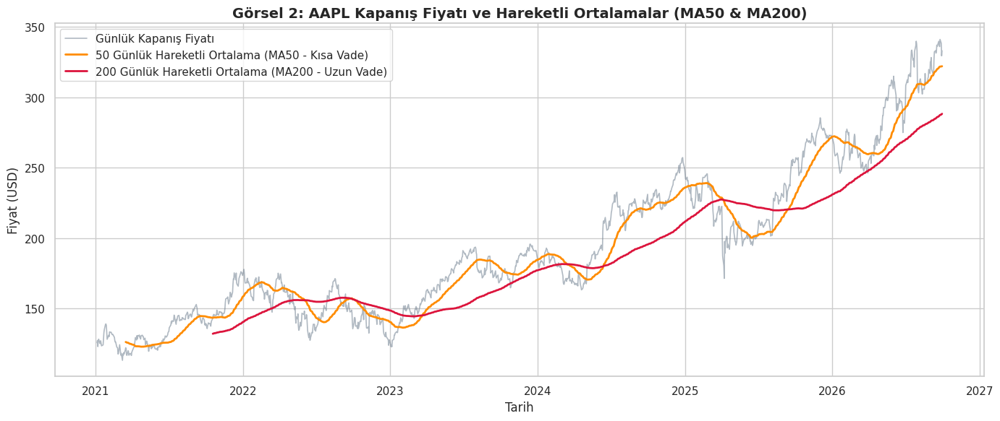
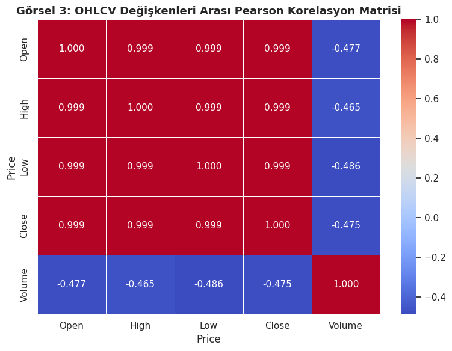
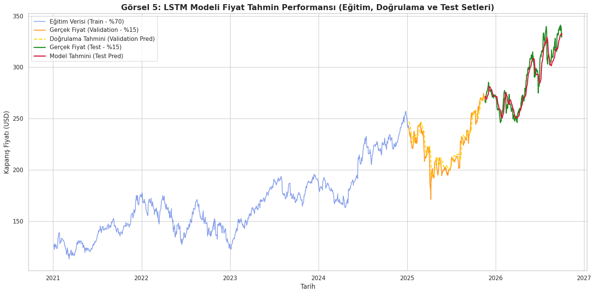
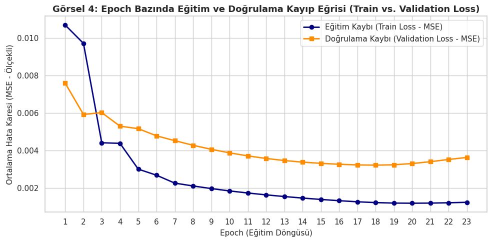

# Apple (AAPL) Hisse Senedi Fiyat Tahmini / Stock Price Prediction with LSTM 📈

[🇹🇷 Türkçe](#-türkçe) | [🇬🇧 English](#-english)

---

# 🇹🇷 Türkçe

Bu proje, Apple Inc. (AAPL) hisse senedinin geçmiş piyasa hareketlerini kullanarak gelecekteki fiyat yönelimini tahmin eden bir **Uzun Kısa Süreli Bellek (LSTM - Long Short-Term Memory)** zaman serisi modelidir. 

Çalışma, gelecekte kurulması planlanan daha kapsamlı ve otonom bir algoritmik ticaret (algorithmic trading) sisteminin **"Fiyat Tahmin Motoru"** altyapısını oluşturmak üzere tasarlanmıştır.

## 🛠 Kullanılan Teknolojiler
* **Python 3.x**
* **TensorFlow / Keras** (LSTM Mimarisi & Derin Öğrenme)
* **yfinance** (Yahoo Finance Finansal Zaman Serisi Veri Çekimi)
* **Pandas & NumPy** (Veri Analizi & Tensör Dönüşümleri)
* **Scikit-learn** (MinMaxScaler ile Normalizasyon)
* **Matplotlib & Seaborn** (Teknik Analiz ve Hata Görselleştirme)

## 📊 Veri Seti ve Ön İşleme
Veri seti `yfinance` API'si üzerinden **1 Ocak 2021 – 1 Ekim 2026** tarihleri arasını kapsayacak şekilde dinamik olarak çekilmiştir. Toplamda 1442 işlem günü ve 5 temel finansal metrik (Open, High, Low, Close, Volume) içermektedir. Hedef değişken (target) **Kapanış (Close)** fiyatı olarak belirlenmiştir.

* **Ölçeklendirme:** Gradyan kaybolmasının (vanishing gradient) önüne geçmek ve aktivasyon fonksiyonlarının verimini artırmak için `MinMaxScaler` ile veriler 0-1 aralığına normalize edilmiştir.
* **Zaman Penceresi (Lookback Window):** Modelin ardışık fiyat örüntülerini yakalayabilmesi amacıyla otoregresif bir pencereleme uygulanmış; *son 60 günün verisi (X) kullanılarak 61. günün kapanış fiyatı (y)* tahmin edilecek şekilde yapılandırılmıştır.
* **Kronolojik Ayrım:** Finansal zaman serilerinin doğasına sadık kalınarak veriler rastgele karıştırılmamış; ilk %80 Eğitim (Train), son %20 Test seti olarak kronolojik sırayla bölünmüştür.

## 🔎 Keşifçi Veri Analizi (EDA)

> **Not:** 50 ve 200 günlük hareketli ortalamalar (MA50 & MA200) incelendiğinde, kısa vadeli ortalamanın uzun vadeli ortalamayı kestiği periyotların trend dönüşümlerini net şekilde yansıttığı tespit edilmiştir.

> **Not:** Fiyat değişkenleri (Open, High, Low, Close) arasında mükemmele yakın (+1.0) pozitif doğrusal ilişki varken; işlem hacmi (Volume) ile fiyatlar arasında zayıf negatif (-0.25) bir korelasyon saptanmıştır.

## 🧠 Model Mimarisi
* **1. Katman:** LSTM (50 Nöron, `return_sequences=True`)
* **2. Katman:** LSTM (50 Nöron, `return_sequences=False`)
* **Tam Bağlantılı Katmanlar (Dense):** 25 Nöron -> 1 Nöron (Regresyon Çıktısı)
* **Optimizasyon & Kayıp Fonksiyonu:** Adam Optimizer, Mean Squared Error (MSE)
* **Eğitim Parametreleri:** 32 Batch Size, 20 Epoch, %10 Validation Split

## 📉 Eğitim ve Doğrulama (Validation) Performansı

> **Çıkarım:** Hem eğitim kaybının hem de doğrulama kaybının istikrarlı bir şekilde sıfıra yaklaşması ve paralel seyretmesi, modelin varyansının dengeli olduğunu ve yeni verilere genelleme yapabilme kabiliyetini doğrulamaktadır.

## 🚀 Sonuçlar ve Hata Analizi
* **Test Performansı (RMSE):** **6.78 USD**

* **Güçlü Yönler:** Model, test dönemindeki genel yükseliş trendini ve orta vadeli dalgalanmaları yüksek bir doğrulukla yakalamıştır.
* **Hata Analizi (Gecikme/Lag Problemi):** Ani fiyat kırılımlarında model tahminlerinin gerçek piyasa hareketini 1 gün geriden takip ettiği (lag) gözlemlenmiştir. Yalnızca geçmiş fiyat hareketlerine dayanan otoregresif modeller, piyasa şoklarını ve anlık haber akışlarını önceden sezemedikleri için bir önceki günün kapanışına yakın güvenli tahminler üretme eğilimindedir.

## 🔮 Gelecek Vizyonu
1. **Duygu Analizi Modülü (NLP):** Finansal haber başlıklarını ve piyasa duyarlılığını işleyen FinBERT tabanlı bir Doğal Dil İşleme katmanının entegre edilmesi.
2. **Multimodal Otonom Sistem:** Teknik göstergeler ile haber akışını birleştirerek "gecikme" sorununu aşan, aracı kurum API'leri ile canlı emir iletebilen tam otonom bir algoritmik ticaret sistemine dönüştürülmesi.

---

# 🇬🇧 English

This project implements a **Long Short-Term Memory (LSTM)** deep learning model to forecast future price movements of Apple Inc. (AAPL) stock based on historical market data.

The project is designed to serve as the core **"Price Forecasting Engine"** for an autonomous, multi-modal algorithmic trading system.

## 🛠 Tech Stack
* **Python 3.x**
* **TensorFlow / Keras** (LSTM Architecture & Deep Learning)
* **yfinance** (Market Data Ingestion via Yahoo Finance API)
* **Pandas & NumPy** (Data Manipulation & Tensor Operations)
* **Scikit-learn** (Feature Scaling via MinMaxScaler)
* **Matplotlib & Seaborn** (Technical Analysis & Performance Visualization)

## 📊 Dataset & Preprocessing
Historical data was pulled dynamically using the `yfinance` library, spanning from **January 1, 2021 to October 1, 2026** (1,442 trading days across 5 core attributes: Open, High, Low, Close, Volume). The target feature is the **Close** price.

* **Normalization:** Data was scaled to the range [0, 1] using `MinMaxScaler` to prevent vanishing gradients and ensure stable neural network convergence.
* **Lookback Window:** An autoregressive framing was constructed using a **60-day lookback window**, where historical price data of the past 60 days ($X$) is used to predict the closing price of day 61 ($y$).
* **Chronological Split:** Preserving the temporal structure of financial time series, the dataset was split chronologically into 80% Training and 20% Testing sets without shuffling.

## 🔎 Exploratory Data Analysis (EDA)

> **Observation:** The 50-day and 200-day Simple Moving Averages (MA50 & MA200) clearly illustrate midterm and long-term trend reversal zones (Golden Cross / Death Cross patterns).

> **Observation:** Price variables (Open, High, Low, Close) exhibit near-perfect positive correlation (+1.0), whereas trading volume displays a mild negative correlation (-0.25) with price levels.

## 🧠 Model Architecture
* **Layer 1:** LSTM (50 Units, `return_sequences=True`)
* **Layer 2:** LSTM (50 Units, `return_sequences=False`)
* **Dense Layers:** 25 Units -> 1 Unit (Linear output)
* **Optimization & Loss:** Adam Optimizer, Mean Squared Error (MSE)
* **Training Specs:** Batch Size = 32, Epochs = 20, Validation Split = 10%

## 📉 Training & Validation Performance

> **Insight:** Both training and validation losses smoothly decline and converge near zero in parallel, indicating absence of overfitting and strong generalization performance.

## 🚀 Results & Error Analysis
* **Test Performance (RMSE):** **6.78 USD**

* **Strengths:** The model effectively captures macro upward rallies and multi-week cyclical price trends.
* **Error Analysis (Lag Effect):** During sharp directional breakouts, the predicted price tends to lag actual prices by approximately one timestep. Autoregressive models relying strictly on historical prices tend to predict values close to $t-1$ as an optimal statistical hedge against sudden market shocks.

## 🔮 Future Roadmap
1. **Sentiment Analysis Module (NLP):** Integrating a FinBERT-based transformer model to evaluate real-time financial news sentiment and macroeconomic headlines.
2. **Multimodal Autonomous Pipeline:** Fusing technical price indicators with news sentiment embeddings to mitigate prediction lag and executing programmatic orders through broker APIs.

---

**Author / Geliştirici:** Rıdvan Efe Birben  
**Links / Bağlantılar:** [Google Colab Notebook](https://colab.research.google.com/drive/1-nHTCQaqRPfP1og0wAziQgKuDJwpG7Id)
